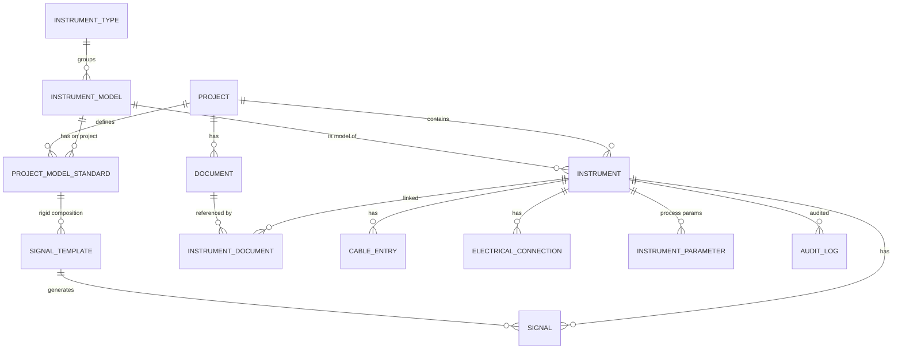

# CORE-RSH-002: Модель данных прибора

**Проект:** KIP_Core
**Статус:** Исследование завершено
**Дата:** 04.11.2026
**Связанные документы:** `docs/SPECIFICATION.md` (разделы «Форматы
обмена», «Глоссарий»), `docs/decisions/CORE-ADR-001-orchestration.md`
(процесс)

---

## 0. Как читать этот документ

- **Раздел 1** — вопрос и контекст.
- **Раздел 2** — как мы обсуждали (пошаговая реконструкция решений).
- **Разделы 3–11** — итоговая модель: три уровня характеристик, справочники, документы, параметры процесса, статус закупки, электрические подключения.
- **Раздел 12** — как всё связано (схема).
- **Раздел 13** — **подробное резюме для управляющего чата** (для ADR-004).
- **Раздел 14** — открытые вопросы и источники.

---

## 1. Вопрос и контекст

Нужно выбрать модель данных для прибора в KIP Register, чтобы:

- набор полей прибора можно было расширять без миграций схемы;
- работать с ~10 тыс. приборов, ~10–20 полями;
- поиск и фильтрация по любому полю — < 1 с;
- UI на Tabulator отображал произвольные наборы колонок;
- импорт из табличных файлов подхватывал колонки;
- ручной ввод показывал форму по текущему набору полей;
- аудит аудировал смысловые поля, не технические.

---

## 2. Как мы обсуждали: пошаговая реконструкция решений

Обсуждение шло по одному шагу: сначала поля по отдельности (`tag`, `type`, `model`), затем три уровня характеристик, затем — остальные группы полей без уровней.

### Шаг 1. Поле `tag` (позиция/индекс)

**Зафиксировано:**
- Хранится **одной текстовой строкой**, без разбиения на префикс/номер/суффикс.
- **Уникален в рамках проекта**; одинаковые теги в разных проектах допустимы.
- **Может меняться** (уточнение после создания — нечасто, но бывает). Аудит фиксирует изменения.
- **Кириллица допустима**; длина — с запасом (ориентир 50 символов, реально обычно меньше 20).
- **Не автогенерируется** — номер уже определён принципиальной схемой.
- **Независим от `type`:** префикс тега обычно совпадает с типом, но не всегда (в начале проекта не все префиксы известны).

**Почему не разбивать на части:** правила построения тегов различаются от проекта к проекту, префиксы могут добавляться в процессе. Единая строка оставляет свободу; для фильтрации — `tag LIKE 'PT-%'`.

### Шаг 2. Поле `type` (тип прибора)

**Зафиксировано:**
- **Справочник типов** — строго из справочника, без произвольного ввода.
- **Формат:** латинские буквы, до 10 символов (реально хватает 5).
- **Назначение:** группировка и фильтрация, статистика.
- **Связь с моделью:** к каждому типу привязаны определённые модели (при выборе типа показываются только модели этого типа).
- **Меняется редко**, но ошибки при вводе часты — аудит фиксирует изменения.

### Шаг 3. Поле `model` (модель прибора)

**Зафиксировано:**
- **Справочник моделей** — строго из справочника, с удобным автодополнением при вводе.
- **Производитель** отдельным полем (подтверждено, что нужен).
- **Модель — жёсткий шаблон:** задаёт перечень характеристик, типовые значения и шаблон сигналов. Инженер не может менять саму модель.
- **Шаблон сигналов перенесён на Уровень 2** (проектные стандарты): модель лишь определяет, какие сигналы для неё в принципе возможны; состав, типы и префиксы фиксируются на уровне проекта.
- **Технические детали** (принцип действия, тип сенсора, габариты, масса, наличие дисплея, материалы, присоединение, базовый диапазон) **в справочнике моделей не храним** — это справочная информация из каталога. Принцип: в базе — только то, что используется для выбора, фильтрации или автоматического создания сигналов.
- **Принцип разделения «жёсткое / переопределяемое»:** жёсткое — то, что в даташите модели не имеет опций; переопределяемое — то, что указано как опция или исполнение.

### Шаг 4. Три уровня характеристик

После обсуждения модели вырисовалась трёхуровневая структура:

- **Уровень 1 — модель (жёстко).** Название, тип, производитель.
- **Уровень 2 — проектный стандарт (для модели на проекте).** Две категории: (А) жёсткие поля — состав сигналов; (Б) значения по умолчанию для характеристик прибора.
- **Уровень 3 — прибор / сигнал (переопределяемо).** Фактические значения, унаследованные из Уровня 2 и переопределённые инженером.

**Ключевое разграничение:** Уровень 2 (А) — «скелет» (состав сигналов), жёсткий. Уровень 2 (Б) — значения по умолчанию для характеристик. Уровень 3 — «плоть»: переопределение значений, видимое и аудируемое; **состав сигналов на Уровне 3 не меняется**.

### Шаг 5. Уровень 2 (А): состав сигналов

**Зафиксировано:** для каждой модели на проекте задаётся жёстко:

| Поле | Что это | Пример |
|---|---|---|
| **Префикс сигнала** | Уникальный в рамках модели | `AI1`, `AO1`, `DI1` |
| **Наименование сигнала** | Понятное название | «давление для КИП», «открыть», «неисправность» |
| **Тип сигнала** | Буквенная категория, до 5 латинских букв | `AI`, `AO`, `DI`, `DO` |

Количество сигналов фиксировано для модели на проекте. Если в редком случае используются не все сигналы модели — оформляется **отдельная модель**, а не «урезание» состава.

### Шаг 6. Уровень 3: характеристики сигнала

**Зафиксировано:** характеристика сигнала — это **электрическая реализация** (не путать с типом сигнала `AI`/`AO`/`DI`/`DO`).

**Справочник характеристик сигнала** (настраиваемый, дополняемый):

| Код | Название |
|---|---|
| `I420` | 4–20 мА |
| `I020` | 0–20 мА |
| `V010` | 0–10 В |
| `HART` | 4–20 мА + HART |
| `DRY_NO` | Сухой контакт, замыкающийся (NO) |
| `DRY_NC` | Сухой контакт, размыкающийся (NC) |
| `NAMUR` | NAMUR |
| `D24` | Дискретный 24 В |

**Диапазон сигнала** не храним отдельным полем (закодирован в характеристике). **Единица измерения** относится к прибору. **Описание сигнала** — лишнее.

### Шаг 7. Уровень 3: характеристики прибора

**Зафиксировано:** переопределяемые для конкретного прибора:

| Характеристика | Способ хранения |
|---|---|
| **IP** | Справочник (ГОСТ/IEC) |
| **Ex** | Справочник (расширяемый) |
| **Климатическое исполнение** | Справочник (ГОСТ 15150) |
| **Диапазон измерений** | Число + единица из справочника |
| **Материал, контактирующий со средой** | Справочник (расширяемый) |
| **Материал корпуса** | Справочник (расширяемый) |
| **Присоединение к процессу** | Тип (справочник) + размер (свободный ввод) |
| **Кабельные вводы** | Набор пар «тип (справочник) + количество (число)» |

**Единицы измерения** — справочник, дополняемый в пределах проекта.

### Шаг 8. Документы

**Зафиксировано:**
- **Один справочник для всех типов документов**, с полем `тип` — чтобы документ можно было выбрать только в соответствующем поле.
- **Поля документа:** номер, ревизия, наименование.
- **Типы документов:** схема принципиальная, схема соединений, монтажный чертёж, чертёж трубопровода / точки подключения (резервируется), опросный лист.
- **Связь «прибор ↔ документы»:** без ограничений по количеству; инженер выбирает вручную из справочника. **Уровни к документам не применяются.**

### Шаг 9. Параметры процесса

**Зафиксировано:** вводит инженер, без уровней:

| Поле | Что это |
|---|---|
| **Измеряемая среда** | Вещество/среда, с которой работает прибор |
| **Расчётное давление** | Давление, на которое рассчитан процесс |
| **Расчётная температура** | Температура, на которую рассчитан процесс |
| **Рабочее давление** | Фактическое давление процесса |
| **Рабочая температура** | Фактическая температура процесса |
| **Диапазон параметра процесса** | Пределы изменения параметра в процессе (не путать с «диапазоном измерений» прибора) |

### Шаг 10. Статус закупки

**Зафиксировано:**
- **Справочник статусов:** `Предложение`, `Согласование`, `Согласован`.
- **Поле «Основание»** — свободный текст (номер и дата письма или иного документа, которым зафиксирован статус). Справочник для оснований не нужен.
- Изменения статуса и основания — **аудируются**.

### Шаг 11. Электрические подключения

**Зафиксировано:** вводит инженер, без уровней:

| Поле | Что это |
|---|---|
| **Принадлежность к системе** | РСУ, ПАЗ, ПЛК или иная система (справочник, расширяемый) |
| **Индекс кабеля** | Уникальный номер/тег кабеля |
| **Марка кабеля** | Например, `СКАБ 250нг(А)-HF` |
| **Типоразмер** | Сечение/количество жил (свободный ввод) |
| **Куда** | Точка подключения (клеммная коробка, шкаф, устройство) |

Пара «Откуда → Куда» соответствует практике кабельных журналов и ГОСТ 21.613-2014. «Откуда» — это сам прибор (его позиция).

---

## 3. Итоговая модель: три уровня характеристик

### 🧱 Уровень 1 — Модель (жёстко, справочник)

Храним **только**:
- **Название модели** (укрупнённое, без полного кода заказа).
- **Привязка к типу** (к какому типу прибора относится).
- **Производитель** (отдельным полем).

Технические детали не храним — это справочная информация из каталога.

### 📐 Уровень 2 — Проектный стандарт (для модели на проекте)

Две категории полей:

**А. Жёсткие поля (не переопределяются для отдельных приборов):**
- Состав сигналов: **префикс**, **наименование**, **тип сигнала**. Количество сигналов фиксировано. Меняется только ответственным при настройке проекта, с аудитом.

**Б. Значения по умолчанию (наследуются Уровнем 3):**
- `IP`, `Ex`, климатическое исполнение, материал контактирующий со средой, материал корпуса, тип присоединения к процессу, тип кабельного ввода.
- (Диапазон измерений, скорее всего, не задаётся на уровне проекта — зависит от задачи измерения. Открытый вопрос.)

### 🔧 Уровень 3 — Прибор / сигнал (переопределяемо)

- Прибор **наследует** значения по умолчанию из Уровня 2 (для своей модели на этом проекте).
- Инженер может **переопределить** любое значение для конкретного прибора.
- Переопределение **видимо** в UI (отличается от унаследованного) и **фиксируется в аудите**.
- Характеристики сигналов (электрическая реализация) — тоже переопределяются для каждого экземпляра сигнала, с теми же правилами.

### 💎 Сводная таблица трёх уровней

| Уровень | Что содержит | Жёсткость |
|---|---|---|
| **1. Модель** | Название, тип, производитель | Жёстко (справочник) |
| **2. Проектный стандарт** | (А) Состав сигналов: префикс, наименование, тип; (Б) Значения по умолчанию для характеристик прибора | (А) жёстко; (Б) по умолчанию для Уровня 3 |
| **3. Прибор / сигнал** | Фактические значения характеристик прибора и сигналов | Наследуется из Уровня 2, переопределяется для экземпляра, видимо, аудируется |

---

## 4. Справочники (все, которые нужны)

| Справочник | Назначение | Дополняется |
|---|---|---|
| `instrument_types` | Типы приборов | Ответственным |
| `instrument_models` | Модели (название, тип, производитель) | Ответственным |
| `signal_characteristics` | Электрические реализации сигналов (`I420`, `HART`, `DRY_NO`, …) | Ответственным |
| `ip_ratings` | Степени защиты IP | Ответственным |
| `ex_markings` | Маркировки Ex | Ответственным |
| `climate_versions` | Климатические исполнения (ГОСТ 15150) | Ответственным |
| `wetted_materials` | Материалы, контактирующие со средой | Ответственным |
| `body_materials` | Материалы корпуса | Ответственным |
| `connection_types` | Типы присоединения к процессу | Ответственным |
| `cable_entry_types` | Типы кабельных вводов | Ответственным |
| `measurement_units` | Единицы измерения | Ответственным |
| `documents` | Документы проекта (тип, номер, ревизия, наименование) | Ответственным |
| `purchase_statuses` | Статусы закупки (`Предложение`, `Согласование`, `Согласован`) | Ответственным |
| `control_systems` | Системы управления (РСУ, ПАЗ, ПЛК) | Ответственным |

**Принцип:** всё, что имеет стандартизованную кодировку (IP, Ex, климат, материалы, типы присоединения/ввода) — в справочники. Всё, что бесконечно вариативно (конкретный диапазон, размер присоединения, индекс кабеля, основание закупки) — свободный ввод или комбинация «справочник + уточнение».

---

## 5. Группы полей без уровней

Эти группы заполняются инженером вручную, не наследуются от модели или проекта, не привязаны к трём уровням.

### 📄 Документы

- Один справочник для всех типов, с полем `тип`.
- Поля: номер, ревизия, наименование.
- Типы: схема принципиальная, схема соединений, монтажный чертёж, чертёж трубопровода / точки подключения, опросный лист.
- Связь «прибор ↔ документы»: без ограничений по количеству; инженер выбирает вручную.

### 🌡️ Параметры процесса

Измеряемая среда, расчётное давление, расчётная температура, рабочее давление, рабочая температура, диапазон параметра процесса.

### 📦 Статус закупки

- Справочник статусов: `Предложение`, `Согласование`, `Согласован`.
- Поле «Основание» — свободный текст (номер и дата письма).
- Аудируется.

### ⚡ Электрические подключения

Принадлежность к системе, индекс кабеля, марка, типоразмер, «Куда». Пара «Откуда → Куда»; «Откуда» — сам прибор.

---

## 6. Как это соотносится с JSONB

Модель данных, зафиксированная в этом ресерче, **не требует** чистого JSONB «для всего». Основные поля (три уровня, документы, параметры процесса, статус, электрика) — это **нормализованные сущности** со справочниками. JSONB остаётся инструментом для **редких, специфических полей**, которые появятся в будущем и не покрыты текущим списком.

**Рекомендация:** реализовать зафиксированные поля как **обычные колонки и связанные таблицы**, а JSONB — как «запасной карман» для будущих расширений. Это даёт:

- **Поиск и фильтрация** по любому зафиксированному полю — с обычными индексами (B-tree), без GIN.
- **Валидация типов** — на уровне колонок и справочников.
- **Понятность** для инженера и для языковых моделей, которые будут сопровождать проект.
- **Совместимость с аудитом** (ADR-003): `field_name` — это имя колонки или справочного поля.

Чистый JSONB (подход 3 из задания) отклоняется: он лишает валидации и усложняет поиск по диапазонам. Гибрид (подход 4) остаётся **резервным** — если в будущем появится много полей, которые действительно есть не у всех.

---

## 7. Схема связей (общая картина)

**Легенда (словами):**
- **Проект** содержит приборы и документы.
- **Тип** группирует модели; **модель** — жёсткий шаблон (название, тип, производитель).
- **Проектный стандарт** для модели: состав сигналов (жёстко) + значения по умолчанию для характеристик.
- **Прибор** ссылается на модель, проект; имеет сигналы, документы, кабельные вводы, электрические подключения, параметры процесса; аудируется.
- **Сигнал** ссылается на прибор и на шаблон из проектного стандарта; имеет переопределяемую электрическую характеристику.

---

## 8. Совместимость с аудитом (ADR-003)

Модель данных хорошо стыкуется с application-level `audit_log`:
- `field_name` для аудита — это имя колонки или справочного поля (`tag`, `type`, `setpoint`, `IP`, `Ex`, `status`, …).
- JSONB для `old_value`/`new_value` в `audit_log` остаётся универсальным.
- Список аудируемых полей (ADR-003: `tag`, `type`, `setpoint`, `range`) расширяется полями из этой модели: `IP`, `Ex`, `status`, `basis` (основание закупки), привязка документов.
- Переопределения на Уровне 3 (значение отличается от унаследованного) — **видимы** в UI и **аудируются**.

---

## 9. Совместимость с импортом

- Импорт CSV/XLSX сопоставляет колонки файла с полями модели (по имени поля или по подписи).
- Если в файле появилась колонка, которой нет в справочниках/полях — **остановить импорт с понятной ошибкой** (рекомендуется) или автосоздать поле (альтернатива, требует отдельного решения).
- Справочные поля (IP, Ex, материалы) при импорте проверяются на соответствие справочнику; несоответствие — ошибка строки.
- Свободные поля (диапазон, размер присоединения, индекс кабеля, основание) импортируются как текст/число.

---

## 10. Совместимость с Tabulator

- Tabulator ожидает плоскую таблицу. Бэкенд отдаёт **плоскую проекцию** прибора (все поля — колонки; сигналы — либо отдельной вкладкой, либо агрегированно).
- Набор колонок для Tabulator формируется из **фиксированного списка полей** (зафиксирован в этом ресерче) + при необходимости из справочников (для выпадающих фильтров).
- Поиск и сортировка — на сервере (Tabulator remote pagination/sorting), чтобы не тянуть 10 тыс. строк в браузер.
- Для 10 тыс. приборов серверный поиск по индексированным колонкам — < 1 с.

---

## 11. Оценка размера

- **Приборы:** 10 тыс. строк × (~30 колонок + связанные таблицы сигналов/документов/кабельных вводов/электрики/параметров процесса). Оценка: **~50–100 МБ** с индексами. Для PostgreSQL ничтожно.
- **Сигналы:** 10 тыс. приборов × ~2–5 сигналов = **20–50 тыс. строк**.
- **Документы:** 10 тыс. приборов × ~2–4 документа = **20–40 тыс. связей**.
- **Кабельные вводы:** 10 тыс. приборов × 1–7 вводов = **10–70 тыс. строк**.
- **Электрические подключения:** 10 тыс. приборов × 1–2 подключения = **10–20 тыс. строк**.
- **Аудит (ADR-003):** ~91 тыс. записей за 5 лет, ~20–45 МБ.

**Вывод:** нормализованная модель с связанными таблицами на нашем масштабе даёт предсказуемый размер и не требует JSONB-трюков.

---

## 12. Отклонённые варианты (из исходного задания)

- **Чистый JSONB без справочника (подход 3)** — лишает валидации типов и усложняет поиск по диапазонам. Отклонён.
- **EAV (подход 2)** — на нашем масштабе (10 тыс. приборов, ~20 полей) даёт ~100 тыс. строк вместо 10 тыс., сложные JOIN’ы, без выигрыша в гибкости. Отклонён.
- **Table-per-type (подход 5)** — слишком много таблиц под каждый тип; не подходит, так как типы и модели — это справочники, а не отдельные таблицы.
- **ALTER TABLE при каждом новом поле (подход 6)** — противоречит требованию «без миграций». Отклонён.
- **Гибрид с JSONB «для всего» (подход 4)** — остаётся **резервным**, если в будущем появится много полей, которые есть не у всех приборов. Сейчас, после детального обсуждения, зафиксированные поля — нормализованные.

---

## 13. Резюме для управляющего чата (для ADR-004)

> Это резюме — подробное, так как оно напрямую влияет на структуру базы данных.

### 13.1. Три уровня характеристик

**Уровень 1 — Модель (жёсткий справочник).** Храним: название модели (укрупнённое), привязка к типу, производитель. Технические детали (принцип действия, габариты, масса, наличие дисплея, материалы) **не храним** — это справочная информация из каталога.

**Уровень 2 — Проектный стандарт (для модели на проекте).** Две категории:
- **(А) Жёсткие поля:** состав сигналов для модели на проекте — префикс, наименование, тип сигнала (`AI`/`AO`/`DI`/`DO`, до 5 латинских букв). Количество сигналов фиксировано.
- **(Б) Значения по умолчанию** для характеристик прибора: `IP`, `Ex`, климатическое исполнение, материал контактирующий со средой, материал корпуса, тип присоединения к процессу, тип кабельного ввода.

**Уровень 3 — Прибор / сигнал (переопределяемо).** Прибор наследует значения по умолчанию из Уровня 2; инженер может переопределить любое значение для конкретного прибора. Переопределение видимо в UI и аудируется.

### 13.2. Поля прибора (зафиксированные)

- **Идентификация:** `tag` (уникален в рамках проекта, может меняться, кириллица, до 50 символов), `type` (справочник, до 10 латинских букв), `model` (справочник).
- **Характеристики прибора (Уровень 3):** `IP`, `Ex`, климатическое исполнение, диапазон измерений (число + единица), материал контактирующий со средой, материал корпуса, присоединение (тип + размер), кабельные вводы (набор пар «тип + количество»).
- **Параметры процесса (вводит инженер):** измеряемая среда, расчётное давление, расчётная температура, рабочее давление, рабочая температура, диапазон параметра процесса.
- **Электрические подключения (вводит инженер):** принадлежность к системе, индекс кабеля, марка, типоразмер, «Куда».
- **Статус закупки:** справочник (`Предложение`, `Согласование`, `Согласован`) + поле «Основание» (свободный текст).
- **Документы:** один справочник с полем `тип`; поля документа — номер, ревизия, наименование; связь «прибор ↔ документы» без ограничений по количеству.

### 13.3. Справочники

Типы, модели, характеристики сигналов (`I420`, `HART`, `DRY_NO`, `DRY_NC`, `NAMUR`, `D24`, `I020`, `V010`), IP, Ex, климат, материалы (контакт и корпус), типы присоединения, типы кабельных вводов, единицы измерения, документы, статусы закупки, системы управления (РСУ/ПАЗ/ПЛК).

### 13.4. Хранение

**Зафиксированные поля — нормализованные колонки и связанные таблицы, не JSONB.** JSONB остаётся «запасным карманом» для будущих редких полей. Это даёт валидацию типов, быстрый поиск (B-tree), простую совместимость с аудитом (ADR-003).

### 13.5. Совместимость

- **С аудитом (ADR-003):** `field_name` — имя колонки/справочного поля; переопределения видимы и аудируются; список аудируемых полей расширяется (`IP`, `Ex`, `status`, `basis`, привязка документов).
- **С импортом:** колонки CSV сопоставляются с полями; справочные поля проверяются на соответствие; неизвестная колонка — ошибка (рекомендуется) или автосоздание (альтернатива).
- **С Tabulator:** плоская проекция прибора, серверный поиск/сортировка, набор колонок из фиксированного списка + справочников.

### 13.6. Размер

10 тыс. приборов + связанные таблицы (сигналы ~20–50 тыс., документы ~20–40 тыс., кабельные вводы ~10–70 тыс., электрика ~10–20 тыс., аудит ~91 тыс. за 5 лет) — **~50–100 МБ** с индексами. Для PostgreSQL ничтожно.

### 13.7. Условия пересмотра

- **Появление большого числа полей, которые есть не у всех приборов** — вернуться к гибриду с JSONB.
- **Требование «добавлять поля пользователем через UI»** — отдельная фича self-service, потребует пересмотра справочников и прав.
- **Рост числа сигналов или документов на прибор** — проверить индексы и план запросов (на нашем масштабе не ожидается).
- **Отказ от трёхуровневой модели** — если заказчик решит, что переопределения не нужны (все приборы строго по стандарту проекта) — упростить до двух уровней.

### 13.8. Что нужно от управляющего чата

1. Утвердить трёхуровневую модель и нормализованное хранение (не JSONB «для всего»).
2. Утвердить список справочников.
3. Утвердить список аудируемых полей (расширение ADR-003).
4. Зафиксировать открытые вопросы (см. раздел 14) — по мере необходимости.
5. Оформить ADR-004.

---

## 14. Открытые вопросы

1. **Диапазон измерений на Уровне 2:** задавать ли значение по умолчанию на уровне проекта, или всегда вводить вручную для прибора (зависит от задачи измерения)?
2. **Импорт:** при появлении неизвестной колонки — ошибка (рекомендуется) или автосоздание поля?
3. **Индекс кабеля:** должен ли быть строго уникальным в рамках проекта, или это справочная строка?
4. **Связь «прибор ↔ документы»:** подтвердить, что ограничений по количеству нет (прибор может ссылаться на несколько документов одного типа).
5. **Смена модели:** при смене модели у прибора — пересоздавать сигналы по новому шаблону, сохраняя переопределения, или сбрасывать переопределения (требует отдельного решения).
6. **`source_scheme`:** в исходном задании упоминалось как «спорное» поле. В текущей модели оно не выделено отдельно — принадлежность к схеме покрывается документами (схема принципиальная). Подтвердить.

---

## 15. Источники

1. PostgreSQL Documentation. *JSON Types* — `jsonb`. https://www.postgresql.org/docs/current/datatype-json.html
2. PostgreSQL Documentation. *Indexes* — B-tree, GIN. https://www.postgresql.org/docs/current/indexes.html
3. PostgreSQL Documentation. *Generated Columns*. https://www.postgresql.org/docs/current/ddl-generated-columns.html
4. PostgreSQL Documentation. *pg_trgm*. https://www.postgresql.org/docs/current/pgtrgm.html
5. Tabulator Documentation. *Remote Pagination*, *Dynamic Columns*. https://tabulator.info/docs/6.3
6. SmartPlant Instrumentation (SPI/INtools) — практика `Instrument Index`, `I/O Tag Assignment`, `I/O Map Report`.
7. Siemens WinCC OA — data point types (шаблоны), instance overrides.
8. Gevernova Workflow — Property Attribute Overrides, audit topic types.
9. ГОСТ 21.408-2013 — состав рабочей документации (схемы, чертежи установок).
10. ГОСТ 21.613-2014 — кабельные журналы (графы «Начало» / «Конец»).
11. ГОСТ 14254-2015 (IEC 60529) — степени защиты IP.
12. ГОСТ 31610.0-2014 (IEC 60079-0) — взрывозащита Ex.
13. ГОСТ 15150-69 — климатические исполнения.
14. ГОСТ 22520-85 — «диапазон измерений (диапазон изменения входной величины)».
15. МИ 2266-2000 — база данных о характеристиках средств измерений (класс точности, пределы, погрешность).
16. AutomatiCS — база данных технических средств, подбор моделей по фильтру.
17. Практика кабельных журналов `From/To` (электротехнические САПР).
18. Обсуждения JSONB vs EAV на Stack Overflow и в блогах PostgreSQL-сообщества (высокорейтинговые ответы).